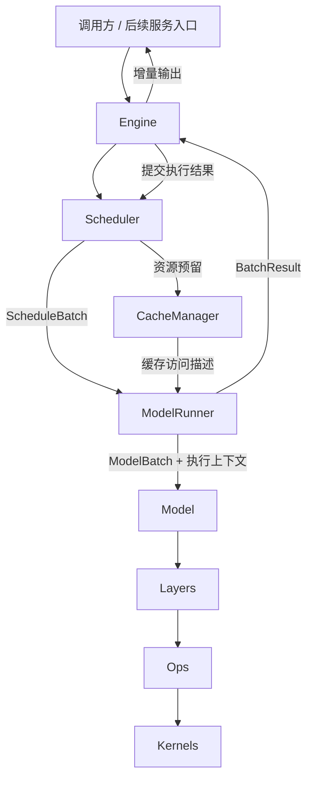

# inferX 推理引擎软件设计

| 项目 | 内容 |
| --- | --- |
| 状态 | 初始设计，待实现验证 |
| 日期 | 2026-11-20 |
| 首个目标模型 | DeepSeek-V4.1-Flash，纯文本推理 |
| 首个交付目标 | 输入一批不同长度的 token IDs，完成 batched prefill 和逐轮 batched decode，返回各请求生成的 token IDs |
| 长期目标 | 支持多模型、请求处理、连续批处理、缓存管理、多卡执行和自定义 kernel 的完整推理引擎 |

## 1. 背景与设计目标

inferX 从单模型推理起步，但整体架构需要支持后续的请求接入、调度、执行、流式输出和性能优化。第一阶段实现最短的端到端执行路径，同时提前确定容易引发架构性重构的契约：请求生命周期、Batch 的阶段表示、设备输入、缓存所有权和算子接口。

设计优先级如下：

1. 正确性：明确 token 消费、采样、缓存更新和请求完成的语义。
2. 可读性：能够沿请求执行链路阅读代码，模型代码能够体现数学计算顺序。
3. 职责明确：请求状态、资源管理、模型计算和 kernel 实现分别集中维护。
4. 可扩展性：增加模型、调度策略或 kernel 时，修改集中在相关模块。
5. 渐进优化：先建立可验证的参考路径，再增加并行、异步和融合优化。

本设计减少跨模块重构，不承诺缓存布局、kernel 参数或性能相关内部实现永久稳定。

## 2. 范围与非目标

### 2.1 第一阶段

- 静态 batch、同步执行；一个 batch 包含多个请求，支持不同 prompt 长度及独立的生成长度和结束条件。一个逻辑执行设备，完整权重部署所需的物理设备方案另行确认。
- 纯文本 token IDs 输入，greedy sampling，token IDs 输出。
- 对 batch 内各请求的完整 prompt 执行 batched prefill；随后每轮为每个未结束请求消费一个 token，执行 batched decode。
- 已结束请求不进入下一轮 Batch，保留稳定的请求到结果映射；本次提交的请求全部结束前不补入新请求。
- 引擎统一分配和释放推理缓存；初始实现可以使用连续存储。
- 支持最大生成长度、EOS、取消和明确的错误反馈。
- 小配置参考验证与完整 checkpoint 验证分开验收。

### 2.2 后续能力

- continuous batching（运行中补入新请求）、chunked prefill、流式服务。
- 分页缓存、prefix caching、抢占和重算。
- 多模型适配、量化、tensor/expert parallel 等并行执行。
- CUDA Graph、异步执行、定制 Triton/CUDA kernel。
- speculative decoding、多模态等功能，分别补充专项设计。

第一阶段不实现通用插件注册系统、分布式 RPC 框架或多层抽象基类。不为尚未验证的实现差异设计大量可选参数。

## 3. 总体架构



图中表示逻辑调用和数据传递，不规定线程或进程部署。第一阶段全部模块可在同一进程、同一控制线程内运行。

### 3.1 术语与命名约定

本文及代码统一使用以下领域词汇。不同类型的前缀表示同一概念在不同处理阶段的表示，不另造同义概念。

| 术语 | 唯一含义 | 代码类型 |
| --- | --- | --- |
| Request（请求） | 一次独立生成任务，跨多个执行轮次存活 | `Request` |
| Batch（批次） | 某一轮共同执行的一组请求及其本轮输入 | `ScheduleBatch`、`ModelBatch` |
| Token | 请求输入或输出的一个 token ID | `input_ids` 等字段 |
| Cache（缓存） | 跨执行轮次保留的设备推理数据 | `CacheManager` 管理 |

命名规则：

- 请求集合统一命名为 `requests`；不使用 `sequences` 指代请求。当前每个 Request 只生成一条输出，不额外引入 Sequence 对象。未来 beam search 等出现真实的一对多需求时另行设计。
- `ScheduleBatch` 是 CPU 侧调度表示；`ModelBatch` 是同一 Batch 的设备计算表示。两者通过 `batch_id` 对应，不再把 Batch 叫作 Plan、Task 或 State。
- `BatchRequest` 是 Request 在一个 Batch 中的不可变执行切片，不是另一份 Request，也不持有请求的完整生命周期。
- `RequestInput` 是创建 Request 的外部参数；`RequestOutput` 是对外输出。它们是输入输出数据，不是独立的请求实体。
- 请求的可变状态直接由 `Request` 持有，不再建立一个含义相同的 `RequestState`。`status` 仅指 WAITING、RUNNING 等生命周期枚举。
- 静态 batching 指运行期间不补入新 Request 的调度策略，不意味着复用一个跨轮可变 Batch。每轮生成新的 Batch；已结束请求不进入下一轮 Batch。
- “序列”仅用于描述 token 的有序排列，不作为请求实体或批次的别名。第三方 kernel 的参数名在适配处转换，不向领域层传播同义词。

### 3.2 模块职责

| 模块 | 负责 | 不负责 |
| --- | --- | --- |
| Engine | 请求入口、主循环、连接调度与执行、交付输出 | 模型数学计算、物理缓存分配算法 |
| Scheduler | 请求状态、本轮 token 预算、选择请求、停止判断、执行结果提交 | CUDA 张量操作、kernel 调用 |
| CacheManager | 资源预留、分配、映射、释放、共享引用和缓存容量 | 采样、模型计算、调度优先级 |
| ModelRunner | 设备输入准备、执行上下文、模型调用、采样、结果取回 | 请求排队和外部协议 |
| Model | 模型结构、权重组织、缓存需求声明 | 请求生命周期、分配和淘汰策略 |
| Layers | 带权重的数学模块及其组合 | 服务协议、请求调度 |
| Ops | 算子语义、张量契约、实现选择 | 请求状态 |
| Kernels | 特定设备上的计算实现 | 模型装载和缓存生命周期 |

ModelRunner 是模型执行的唯一入口。下文简称 Runner 时均指 ModelRunner。Scheduler 不直接调用 Model；Model 不持有 Engine、Scheduler 或 CacheManager。

## 4. 代码组织

```text
inferX/
├── docs/design/architecture.md
├── src/inferx/
│   ├── engine.py
│   ├── config.py
│   ├── protocol/
│   │   ├── request.py
│   │   └── output.py
│   ├── scheduler/
│   │   ├── scheduler.py
│   │   ├── request.py
│   │   └── batch.py
│   ├── cache/
│   │   ├── spec.py
│   │   ├── manager.py
│   │   └── pool.py
│   ├── runtime/
│   │   ├── runner.py
│   │   ├── batch.py
│   │   ├── sampling.py
│   │   └── attention/
│   ├── models/
│   │   ├── interface.py
│   │   ├── loading.py
│   │   └── deepseek_v41/
│   │       ├── config.py
│   │       ├── model.py
│   │       ├── block.py
│   │       ├── attention.py
│   │       ├── compressor.py
│   │       ├── indexer.py
│   │       ├── moe.py
│   │       ├── mhc.py
│   │       ├── engram.py
│   │       └── weights.py
│   ├── layers/
│   ├── ops/
│   └── kernels/
│       ├── triton/
│       └── cuda/
├── examples/generate_ids.py
└── tests/
    ├── scheduler/
    ├── cache/
    ├── runtime/
    ├── models/
    └── kernels/
```

目录表达职责规划，实现时按需要建立文件。模型特有的 attention、MoE 等先保留在模型目录；出现真实的复用需求后再提取。基础计算数学语义一致时才进入公共 layers 或 ops。

## 5. 数据模型与接口契约

以下为接口草图，不是可直接运行的代码。具体类型在实现中补齐；不依赖任意字典传递核心状态。

### 5.1 请求与输出

`RequestInput` 包含 request ID、prompt IDs、采样参数、最大生成长度和停止 token IDs。第一阶段仅支持 greedy，不支持的采样参数明确拒绝。

`RequestOutput` 包含 request ID、本次新增的 token IDs、是否结束以及结束原因。结束原因区分 EOS、长度限制、取消和错误。流式增量默认包含本轮采样得到的 EOS ID，文本展示策略由后续服务层决定。

```python
class Engine:
    def add_request(self, request: RequestInput) -> None: ...
    def step(self) -> list[RequestOutput]: ...
    def abort_request(self, request_id: str) -> None: ...
    def generate_batch(
        self, requests: list[RequestInput]
    ) -> list[RequestOutput]: ...
    def generate(self, request: RequestInput) -> RequestOutput: ...
```

`generate_batch` 一次提交一组请求 并重复执行 `step`，最终按输入顺序返回每个请求的完整输出；`step` 返回增量输出。`generate` 是 batch size 为一的便利接口。首版对超出 max_batch_size 或总资源预算的 batch 明确拒绝，不静默拆批。重复 request ID、空 prompt、非法 token ID、超出容量和不支持的参数需要明确报错。`max_new_tokens == 0` 直接结束，不执行模型。

### 5.2 Request

Request 是跨轮存活的请求实体，由 Scheduler 独占修改，保存 prompt、生成 token、已计算长度、生命周期状态和停止条件，不直接持有设备张量。

核心不变量：

- `num_computed_tokens` 表示已实际送入模型并成功提交的 token 数。
- 采样得到的新 token 加入生成历史，但尚未进入缓存。
- prompt 长度为 P 时，prefill 成功后已计算长度为 P；消费首个生成 token 的 decode 完成后变为 P + 1。
- 已完成请求不再调度；资源释放必须恰好完成一次。

### 5.3 ScheduleBatch

ScheduleBatch 是 Scheduler 构建的本轮 Batch 的 CPU 表示，构建完成后不再修改。包含 batch ID，以及每个请求的 request ID、逻辑起始位置、本轮输入 token IDs、是否需要采样和缓存预留标识。

```python
@dataclass(frozen=True)
class BatchRequest:
    request_id: str
    start_pos: int
    input_ids: tuple[int, ...]
    sample: bool

@dataclass(frozen=True)
class ScheduleBatch:
    batch_id: int
    requests: tuple[BatchRequest, ...]
    reservation: CacheReservation
```

同一 Request 可以依次出现在多个 Batch 中，但同一 Batch 内不得重复 request ID。BatchRequest 保存本轮输入快照，不引用可变 Request。

prompt 中间 chunk 不采样；最后一个 prompt chunk 和正常 decode 需要采样。ScheduleBatch 不携带 HTTP 对象或模型内部张量。

### 5.4 ModelBatch

ModelRunner 将 ScheduleBatch 转换为 ModelBatch：

| 字段 | 语义 |
| --- | --- |
| batch_id | 与 ScheduleBatch 对应的本轮标识 |
| input_ids | 展平的输入 token，形状 `[total_tokens]` |
| positions | 每个输入 token 在请求 token 历史中的绝对位置 |
| request_offsets | 各请求输入区间边界，长度为请求数加一 |
| context_lengths | 各请求本轮消费后的逻辑 token 数（历史已计算 token 数加本轮输入 token 数） |
| logits_indices | 本轮需要计算输出 logits 的输入位置 |

第一阶段采用 packed/ragged 输入：不同长度 prompt 拼接为展平 token，request_offsets 划分各请求；attention 必须保证请求之间不可见。B 个活跃请求在 decode 时有 B 个输入 token；logits_indices 在 prefill 时指向每条 prompt 的最后位置，在 decode 时指向每个请求当前输入位置。padding 若被某个 backend 使用，仅属于其内部布局，不能作为真实 token 更新逻辑位置或缓存。

第一阶段即保留请求分段语义。整个 batch 不用单一 `is_prefill` 表达执行语义；输入长度为一也可能是 prefill。后续 backend 可以根据每个请求的历史长度和本轮输入长度选择路径，也可以将混合 batch拆成多个同类执行批次。

### 5.5 Batch 转换与结果归属

```text
Request（跨轮持有）
    → Scheduler 构建 ScheduleBatch（本轮 CPU 表示）
    → ModelRunner 构建 ModelBatch（本轮设备表示）
    → ModelRunner 返回 BatchResult
    → Scheduler 更新 Request
```

两种 Batch 不相互继承，也不共用一个包含大量可选字段的基类。转换是逻辑输入到设备张量的转换，不是逐字段换名复制。ScheduleBatch 的 `requests[i]` 对应 ModelBatch 的第 i 个请求区间；采样行通过 `logits_indices` 和 Runner 保留的映射对应 request ID。BatchResult 使用 batch ID 和 request ID 标识归属，不能仅依赖输出行号。

### 5.6 模型与执行接口

```python
class InferenceModel(Protocol):
    def get_cache_spec(self) -> ModelCacheSpec: ...
    def forward(
        self, batch: ModelBatch, context: ModelExecutionContext
    ) -> ModelOutput: ...

class ModelRunner:
    def execute(self, batch: ScheduleBatch) -> BatchResult: ...
```

`ModelExecutionContext` 提供本轮缓存视图、attention 元数据和临时工作空间，不提供分配、释放或淘汰请求的能力。不同模型所需的附加执行状态通过明确的类型表达。

模型返回指定位置的 logits；Runner 负责采样。第一阶段 logits 为完整词表，后续分布式 logits 布局由 Runner 内部处理。`BatchResult` 包含batch ID、各请求消费数量、采样结果和失败信息；Scheduler 据此提交逻辑进度。

## 6. 缓存与推理状态管理

### 6.1 统一所有权

KV 缓存由引擎统一管理，模型不得自行维护请求级分配器。CacheManager 管理请求到资源的映射，Pool 持有设备存储，算子只读写已分配区域。

模型初始化时声明静态需求，包括缓存种类、逻辑维度、dtype、窗口或压缩语义、生产层及共享关系。运行时结合 backend 支持的布局，将逻辑规格解析为物理存储规格，再创建 Pool。

缓存规格可以按类型使用不同 dataclass，不要求普通 KV、压缩缓存和窗口缓存共享一个巨大结构。模型不需要为了适应统一管理而丢失自己的缓存语义。

### 6.2 分配与执行生命周期

1. Scheduler 提出本轮 token 消费需求。
2. CacheManager 预留全部必要资源，返回 reservation；失败时不留下部分分配。
3. Scheduler 发布引用该 reservation 的 ScheduleBatch。
4. Runner 将逻辑映射转换为设备访问元数据。
5. 算子写入已预留区域，执行完成后返回结果。
6. Scheduler 提交已计算长度和新 token；CacheManager 提交资源使用记录。
7. 请求结束或取消后释放资源。

第一阶段采用同步执行：GPU 工作完成之前不复用相关资源。后续异步执行必须通过完成事件延迟回收，不能仅根据请求已经取消就释放在途缓存。

模型执行失败可能已部分修改设备缓存。第一阶段将受影响请求标记为失败并清理资源，不尝试回滚张量或从部分状态继续执行。CUDA 上下文失效等进程级错误需要终止执行实例。

### 6.3 分页、共享与前缀复用

初始连续分配器和后续分页分配器提供相同的资源生命周期语义，但物理访问元数据允许变化。模型数学计算不读取物理块编号；attention backend 和相关算子负责解释布局。

跨层共享属于模型内部的静态关系，应按生产者建立存储，消费者引用同一资源。跨请求 prefix sharing 属于运行时复用，需要引用计数、不可变共享区域以及必要的 copy-on-write。

未来 prefix cache 的命中条件必须包括模型/权重版本、相关执行配置和 token 前缀，并恢复该前缀继续推理所需的完整状态。只命中 KV 而缺失压缩器或 Engram 等状态时，不得宣称该前缀可直接复用。

### 6.4 非 KV 状态

压缩器未完成的片段、必要的 indexer 历史和 Engram 历史属于跨 step 持久状态，由运行时状态池按请求管理。它们不必采用 KV 分页布局。

本轮候选集合、top-k 结果和跨层临时中间结果属于单次 forward 工作空间，执行结束即失效。持久状态与临时结果禁止通过进程全局变量混用。

## 7. 调度与执行流程

### 7.1 请求生命周期

```text
WAITING → RUNNING → FINISHED
                 → FAILED
WAITING / RUNNING → CANCELLED
```

第一阶段静态 batching：开始执行前固定本次提交的请求集合，一起执行完整 prefill；随后每轮为所有未结束请求执行一个 decode token。达到各自停止条件的请求退出活跃集合并释放资源，剩余请求继续。新到达请求等待本次提交的所有请求完成。

下一轮 Batch 移除已结束请求后，行号可能变化，request ID 与缓存资源归属不能随行号变化。Runner 为每轮建立输出行到 request ID 的映射；输出按该映射提交，不以当前行号作为持久身份。max_new_tokens 为零的请求直接完成，不占用设备 batch。

### 7.2 Prefill

1. 校验请求并建立 Request。
2. 预留 prompt 所需资源，构建 ScheduleBatch。
3. Runner 构建设备输入和缓存元数据。
4. 模型执行 prompt，填充缓存，输出最后位置的 logits。
5. Runner 采样首个生成 token。
6. Scheduler 提交 prompt 已计算长度和生成 token，检查停止条件。
7. Engine 返回增量输出。

### 7.3 Decode

1. 选择尚未送入模型的最新生成 token。
2. 为该 token 预留资源并构建 ScheduleBatch。
3. 模型读取历史缓存、写入当前 token 对应状态、输出 logits。
4. Runner 采样下一个 token。
5. Scheduler 增加已计算长度，追加生成 token，并判断是否结束。

### 7.4 后续调度扩展

continuous batching 允许运行中加入请求，并可能在同一轮混合不同执行阶段；chunked prefill 改变每个请求本轮消费量；抢占改变请求和资源状态。它们复用batch 与结果契约，但需要分别增加正确性验证。首版不预设最优调度策略。

## 8. 模型、权重与 kernel

### 8.1 模型适配

首个模型在独立目录实现。新增模型需要提供配置解析、权重加载、模型计算、缓存规格和参考对齐测试。初期通过显式分支选择模型，真实插件需求出现后再考虑注册机制。

DeepSeek-V4.1 的压缩、索引、跨层共享及配置启用的附加状态需要按所选 checkpoint 验证。纯文本路径可以不执行视觉模块；未使用的辅助预测模块应明确列出，不能依赖宽松加载静默忽略缺失权重。

### 8.2 权重加载

模型专属 loader 负责参数名映射和模型特有转换；通用文件读取逻辑可共享。加载必须验证参数覆盖率、shape、dtype 和量化 scale。明确区分模型配置与运行配置，并在启动日志中记录实际 checkpoint revision。

完整模型的内存需求按存储权重、缓存和工作空间计算，不能按每 token 激活参数量估算。目标硬件、量化格式与并行方式未确定前，不承诺完整 checkpoint 单卡运行。

### 8.3 算子契约

优先为 attention、量化 GEMM、MoE、normalization、压缩和索引建立明确接口。每个接口说明 shape、dtype、布局、原地更新、数值精度和 stream 约定。

算子实现选择放在 Ops 或 attention backend 内，模型不散布设备判断。普通 PyTorch 张量操作无需全部包装。模型特有算子保留具体语义，不通过大量可选参数伪装成通用算子。

参考实现用于小尺寸验证；优化 kernel 与参考路径保持语义一致。引入融合后，仍保留能定位数值差异的验证入口。

## 9. 配置、错误处理与可观测性

配置分为模型配置、运行配置和请求采样配置。运行配置至少包括设备、执行精度、缓存预算、每请求最大 token 数和调试选项。默认值集中定义，不使用跨模块可变全局配置。

错误分为输入错误、资源不足、请求执行失败和执行实例不可恢复错误。资源不足在调度前处理；第一阶段对无法满足的请求明确拒绝，后续可选择等待、抢占或重算。

初始日志记录 request ID、batch ID、prefill/decode token 数、执行时间、缓存占用与结束原因。不默认记录完整 prompt。性能测量区分 CPU 调度耗时和 GPU 执行耗时，避免把异步提交时间误当计算时间。

## 10. 验证与验收

| 验证项 | 通过标准 |
| --- | --- |
| 首 token 与多步 decode | 在固定输入和精度下，与选定参考实现对齐 logits；记录明确误差阈值 |
| token 消费语义 | prefill、decode 的已计算长度和生成长度符合第 5 节不变量 |
| 增量正确性 | 在模型允许的分段方式下，整体与分段执行结果一致；覆盖窗口与压缩边界 |
| 缓存生命周期 | 分配失败无泄漏，结束/取消释放完整，无重复释放 |
| batch 正确性 | 不同 prompt 长度组成 batch，与逐请求独立执行的 logits 在容差内一致；覆盖 batch size 为一及最大支持值 |
| 请求隔离 | 请求间 attention 和缓存互不污染；改变 batch 排列不改变对应请求的结果 |
| 独立结束与映射 | EOS、不同生成长度和取消导致 batch 缩小时，剩余请求输出归属及缓存映射保持正确 |
| 模型加载 | 核心参数和量化 scale 完整，未使用参数有明确说明 |
| kernel | 边界 shape、dtype、非连续布局支持范围及数值误差经过验证 |
| 性能基线 | 固定硬件、权重版本和输入长度，记录 prefill 延迟、decode 延迟与峰值内存 |

参考实现、checkpoint 和配置需固定 revision。logits 误差阈值应根据精度和参考路径实测确定，不以生成文本看似正常代替数值验证。

## 11. 实施阶段

| 阶段 | 交付物 | 完成条件 |
| --- | --- | --- |
| M0：最小 batch 执行骨架 | Engine、静态 batching Scheduler、Runner、CacheManager、小配置模型 | 不同长度请求的 batched prefill/decode 闭环；独立结束、输出映射与缓存生命周期测试通过 |
| M1：目标模型正确性 | DeepSeek-V4.1 文本路径、严格加载、所需量化运算 | 固定 checkpoint 的 prefill 和连续 decode 对齐；完整硬件方案可运行 |
| M2：动态批处理 | continuous batching、分页缓存、chunked prefill | 动态加入请求、多请求隔离、容量压力与边界测试通过 |
| M3：服务与资源策略 | 流式入口、取消、prefix cache、抢占策略 | 请求生命周期和共享资源回收正确 |
| M4：性能与分布式 | 定制 kernel、CUDA Graph、并行执行 | 正确性回归通过，基准证明收益 |

如果完整 checkpoint 必须多卡才能运行，必要的并行执行应提前进入 M1；阶段顺序不应阻止目标模型实际部署。

## 12. 主要设计决策与待确认项

### 12.1 已确定

- 缓存资源由引擎统一管理，模型只声明需求并读写被授权的缓存视图。
- 调度使用 CPU 侧逻辑状态，Runner 构造设备输入。
- 采用展平 token 与请求分段，避免将固定 batch shape 写入模型契约。
- 调度进度仅在执行成功后提交；设备失败不尝试恢复部分写入的请求。
- 先保留具体实现，只有真实变化点才引入抽象；不建立普遍的基类继承体系。

### 12.2 待实现前确认

- 目标 checkpoint 的精确 revision，以及原始权重和量化格式。
- 首次完整模型运行的 GPU 型号、数量、内存与互联条件。
- 首版缓存布局与 attention backend 的组合。
- 参考实现版本、数值容差和性能基准输入。
- 是否需要从 M1 起支持多卡；若需要，补充分布式执行专项设计。

## 13. 参考资料

- [DeepSeek-V4.1-Flash 官方推理实现](https://huggingface.co/deepseek-ai/DeepSeek-V4.1-Flash/blob/main/inference/model.py)：用于核对模型数学结构、共享关系和附加状态。链接当前指向 main，实现验收前需要固定 revision。
- 本文为 inferX 的架构设计，不要求沿用参考实现的全局变量、缓存所有权或采样组织方式。
